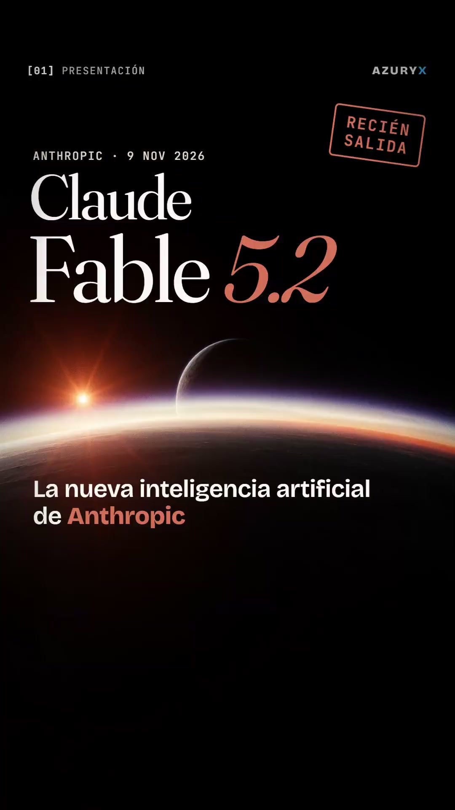

# link-a-video

Skill para [Claude Code](https://claude.com/claude-code): le das un **link** o un **guion** y devuelve un **video vertical 1080×1920** listo para TikTok, Reels o Shorts.

- Guion verificado contra la fuente (cada cifra se busca en el texto de la página).
- Voz y música original con **ElevenLabs** (la música se compone por secciones alineadas a las escenas).
- Imágenes generadas en un **Space de Hugging Face** (por defecto Qwen-Image).
- **Motion graphics** en HTML: texto cinético, contadores, gráficos y subtítulos palabra por palabra, renderizados fotograma a fotograma con Chrome sin ventana y ffmpeg.
- Efectos de sonido sintetizados en la misma tonalidad que la música, mezcla a −14 LUFS, portada y texto para publicar.



## Instalación

```bash
git clone https://github.com/javier321jg/link-a-video ~/.claude/skills/link-a-video
```

Necesitas `ffmpeg`, Node.js 18+, Python 3.10+ con `numpy`, Chrome o Edge, una clave de ElevenLabs y sesión en Hugging Face (`hf auth login`).
Copia `assets/kit/.env.example` a `~/.link-a-video.env` y pon ahí `ELEVENLABS_API_KEY` y `ELEVENLABS_VOICE_ID`.

## Uso

En Claude Code:

> hazme un video para TikTok de este link: https://…

o

> convierte este guion en un video vertical de 60 segundos: …

Claude sigue `SKILL.md`: crea el proyecto, investiga la fuente, escribe el guion, genera voz, música e imágenes, anima, revisa fotogramas, mezcla y renderiza.

## Qué hay dentro

| Ruta | Contenido |
|---|---|
| `SKILL.md` | El flujo completo y las reglas de contenido |
| `scripts/new_project.py` | Crea un proyecto con el kit dentro |
| `assets/kit/` | Motor de animación (`engine.js`, `base.css`), plantilla y scripts: voz, línea de tiempo, música, imágenes, efectos, mezcla, fotogramas de prueba, render y entrega |
| `references/` | API del motor y lecciones aprendidas |
| `examples/fable52/` | Un video completo de 11 escenas como referencia |

## Avisos

- Los videos gastan créditos de ElevenLabs y cuota ZeroGPU de tu cuenta de Hugging Face.
- Etiqueta lo que publiques como contenido generado con IA y cita la fuente.
- Las tipografías (Fraunces, Bricolage Grotesque, JetBrains Mono) y GSAP se instalan desde npm con sus propias licencias.
