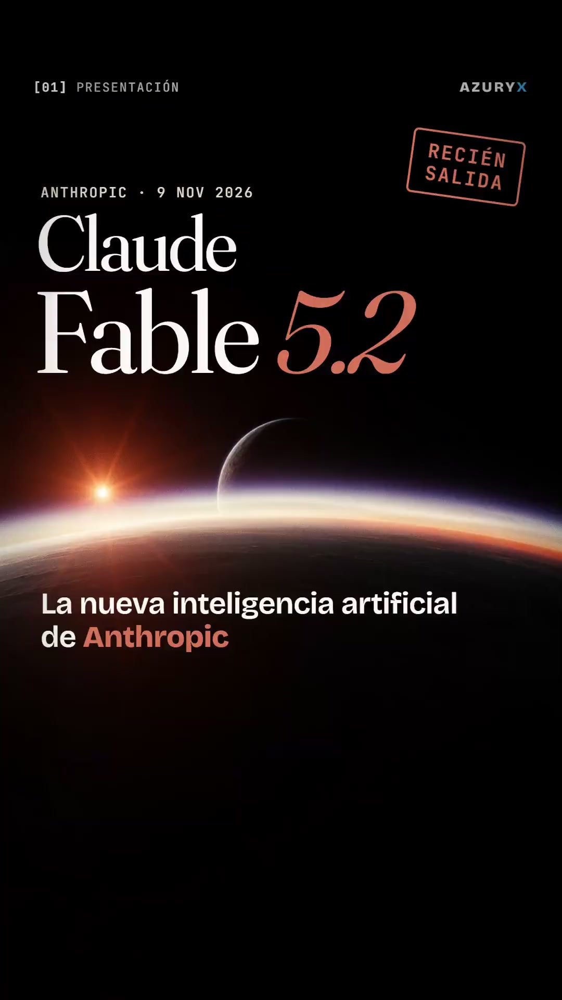

# Ejemplo: "Claude Fable 5.2 en 97 segundos"

Video real hecho con esta skill a partir de https://www.anthropic.com/claude-fable-and-mythos-5-2 (11 escenas, 97 s, 1080×1920 a 60 fps).

| Archivo | Qué muestra |
|---|---|
| `script.json` | Guion por segmentos con el marcado `{pantalla|hablado}`, pausas, `start_at` y `duration` fijos |
| `music.json` | Plan de música por secciones ancladas a escenas, con final sostenido |
| `sfx_events.json` | 13 cortes y 65 efectos anclados a palabras |
| `mix.json` | Un silencio dramático (`dips`) y subida de la música en el cierre |
| `video.html` | Las 11 escenas: texto cinético, contadores, 1,000 puntos en canvas, interfaz sobre una foto, gráficos de barras, ticket de precios, tarjeta final con logo opcional |

No incluye audio ni imágenes generadas. Para verlo moverse, crea un proyecto, copia estos archivos a `work/` y genera voz, música e imágenes con los pasos de `SKILL.md`. Los fondos se pidieron al Space `linoyts/qwen-image-2-1-realtime` con nombres `horizon`, `twins`, `speed2`, `fermat`, `os`, `blackhole`, `pcb`, `robot` y `swarm`, todos con el sufijo "Cinematic, minimal, subtle film grain, vertical composition, no text, no watermark."
